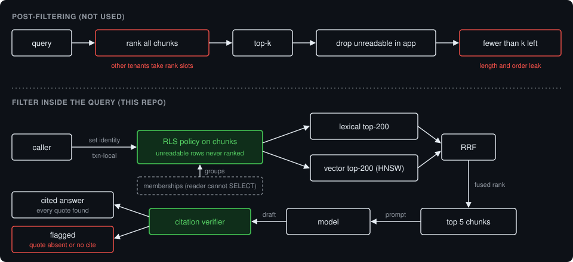

# permissioned-rag

Question answering over a document collection where each caller may only see some of the documents. Access control is enforced by PostgreSQL row-level security inside every retrieval query, before anything is ranked, and every citation in a generated answer is checked against the exact text that was sent to the model.

Retrieval quality, access-control leakage, revocation, answer quality, cost and latency are measured on BEIR FiQA-2018 (57,638 documents, 648 test queries) on one laptop. Every number below comes from a file in `results/` produced by the command listed next to it.

<p align="center"></p>

Filtering after ranking lets documents the caller cannot read occupy rank positions, so the length and order of the results depend on other tenants' data. Here the policy is part of both retrieval queries, so those rows never get a rank, and the answer is checked quote by quote against the chunks the model was given.

## Results

Hardware: MacBook Pro, Apple M2 (4 performance + 4 efficiency cores), 16 GB RAM, macOS 26.1. PostgreSQL 17.12 with pgvector 0.8.7, `shared_buffers` 1 GB. The machine was not idle: other user processes (including a video encoder) were running during the measurements.

### Retrieval (FiQA test, `prag eval retrieval`, `results/retrieval_test.json`)

Corpus scope: the BYPASSRLS benchmark role searches all 76,026 chunks, so the numbers are comparable with published FiQA results (BM25 in the BEIR paper: nDCG@10 0.236).

| Method | nDCG@10 | Recall@100 | MRR@10 | p50 ms | p95 ms |
|---|---|---|---|---|---|
| Lexical (`ts_rank_cd`, OR query) | 0.078 | 0.305 | 0.093 | 207.8 | 657.7 |
| Vector (e5-small, HNSW cosine) | **0.346** | **0.650** | **0.419** | 4.8 | 8.7 |
| Hybrid (RRF k=60) | 0.252 | 0.631 | 0.312 | 213.5 | 662.5 |
| Hybrid + cross-encoder rerank | not measured | | | | |

Permissioned scope: each query is asked by one of 24 synthetic principals through the RLS-restricted role; relevance judgments are cut to documents that principal may read. 377 of 648 queries keep at least one readable relevant document; the other 271 are excluded. A principal sees between 4% and 25% of the corpus, so these numbers are higher than the corpus ones and must not be compared with them.

| Method | nDCG@10 | Recall@100 | MRR@10 | p50 ms | p95 ms |
|---|---|---|---|---|---|
| Lexical | 0.174 | 0.538 | 0.154 | 33.4 | 103.7 |
| Vector | **0.496** | **0.809** | **0.491** | 22.5 | 44.7 |
| Hybrid (RRF) | 0.391 | 0.805 | 0.367 | 57.6 | 131.9 |

Latency is database time per query, measured inside the evaluation loop; query embedding adds about 10 ms (p50, single query on the M2 GPU).

### Access control (`prag eval acl`, `results/acl.json`)

| Check | Result |
|---|---|
| Queries x principals (all 648 test queries, 4 principals each, all 24 principals covered) | 2,592 runs |
| Returned chunks checked against an independent Python oracle (lexical, vector, hybrid) | 1,939,289 |
| Cross-tenant chunks returned | **0** |
| Same-tenant chunks returned without a matching group | **0** |
| Forged chunk ids requested directly / returned without permission | 51,840 / **0** |
| Rows returned with no identity set | **0** |
| Lexical results identical to the auditor applying the same filter by hand (100 queries) | 100 / 100 |
| Vector result-set overlap with exact hand-filtered kNN (100 queries) | 0.951 (see design notes: prepared generic plans use filtered HNSW) |
| Membership revoked, chunk gone on the first query after COMMIT | 50 / 50 |
| Document ACL changed, chunk gone on the first query after COMMIT | 50 / 50 |
| Revoke COMMIT latency p50 / p95 | 0.23 / 0.29 ms |
| First query after COMMIT, p50 / p95 | 35.6 / 67.1 ms |

There is no cache between the policy and the data, so revocation takes effect for any query that starts after the COMMIT returns.

### Answers (`prag eval answers`, `results/answers_*.json`)

50 fixed cases from FiQA test: 30 answerable (a readable relevant chunk is in the context), 10 where the caller can read no relevant document, 10 with the context of an unrelated question swapped in. Context is the top 5 hybrid chunks, no reranker.

| | Qwen3-1.7B 4-bit (MLX, local) | Claude Haiku 5.5 | Claude Sonnet 5.5 |
|---|---|---|---|
| Citation validity (non-refused answers) | 7 / 50 = **14%** | 33 / 38 = **87%** | 28 / 34 = **82%** |
| Answers with at least one checked quote | | 19 | 34 |
| Invalid: invented or altered quotes | 63 quote mismatches across the 43 invalid answers | 3 | 6 |
| Invalid: answered and refused in the same reply | 12 | 3 | 0 |
| Refused when the context is another question's (swapped) | 0 / 10 | **10 / 10** | **10 / 10** |
| Refused when the caller can read no relevant document (ACL-blocked) | 0 / 10 | 2 / 10 | 5 / 10 |
| False refusals on answerable cases | 0 / 30 | 0 / 30 | 1 / 30 |
| Judge score, 1 to 5, answerable cases | 4.03 (judged by itself, see below) | not reported (see below) | not reported (see below) |
| Mean tokens in / out | 1,100 / 111 (Qwen tokenizer) | 1,502 / 135 | 1,502 / 144 |
| Cost per 1,000 queries | $0 API (hardware and energy not counted) | $0.22 | $4.44 |
| Generation latency p50 / p95 | 3.40 / 4.58 s | 1.39 / 1.98 s | 2.41 / 2.92 s |
| End-to-end p50 / p95 (embed + retrieve + generate) | 3.46 / 4.63 s | 1.49 / 2.04 s | 2.48 / 3.03 s |

The local model fails the citation contract most of the time: it puts quotation marks around paraphrases, and it never says it cannot answer. The verifier flags these instead of passing them; a sample of the flagged quotes was checked by hand against the chunk text and they are genuinely absent. The judge score of 4.03 comes from the same 1.7B model grading its own answers and disagrees with the verifier, which is the reason it should not be trusted.

Both Claude models keep the citation contract most of the time and always refuse when the context belongs to another question. Sonnet quotes in every answer it gives (34 of 34) and so has more chances to misquote; Haiku quotes in 19 of 38. The low refusal rate on ACL-blocked cases is partly the label: FiQA judgments are incomplete, so the readable chunks often do contain a usable answer that no annotator marked. Hosted latency includes the network round trip from Poland.

### Hosted model runs (`results/claude_cost_plan.json`, `results/answers_claude-*.json`)

The adapters are in `src/prag/generation/anthropic_api.py`; the key is read only from `ANTHROPIC_API_KEY`, and without it the adapter reports "not configured" and prints the plan instead of sending anything. Prices are in `config/prices.toml`, dated 2026-11-12.

```
ANTHROPIC_API_KEY=... prag eval answers --model claude-haiku-5-5  --sample 50
ANTHROPIC_API_KEY=... prag eval answers --model claude-sonnet-5-5 --sample 50
ANTHROPIC_API_KEY=... prag eval rejudge --model claude-haiku-5-5   # judge saved answers again, no regeneration
prag eval answers --plan-only --sample 50      # prints the estimate, sends nothing
```

The plan was made before anything was sent, with the Qwen3 tokenizer because Claude's is not available offline. It estimated $0.32 for both runs (upper bound $0.52). Claude's tokenizer counted 1,502 input tokens per prompt against the plan's 1,093, so real input was about 37% higher than planned, close to the 35% margin in the upper bound. Measured answer cost: Haiku $0.011 and Sonnet $0.22 for 50 calls each.

The judge scores for the hosted runs are not reported. The first judge run capped replies at 16 tokens; Claude Sonnet 5.5 explains before it scores, so 29 of 30 replies were cut off before the score line. The limit and the parser are fixed (`tests/test_judge_parse.py`), and `prag eval rejudge` grades the saved answers again without generating them anew. Citation validity and refusals above come from the deterministic verifier, not from the judge.

### Load (`prag eval load`, `results/load.json`)

One request = set identity, lexical top-200, vector top-200, RRF, in one transaction, under RLS. Query embeddings were computed before the clock started. 20 s per level after 3 s warm-up, one connection per client.

| Clients | Requests | QPS | p50 ms | p95 ms | p99 ms | Errors |
|---|---|---|---|---|---|---|
| 1 | 303 | 15.2 | 55.9 | 134.1 | 199.3 | 0 |
| 8 | 1,447 | 72.3 | 97.8 | 204.4 | 301.8 | 0 |
| 32 | 1,460 | 73.0 | 393.5 | 800.1 | 1,115.1 | 0 |

Throughput saturates at about 73 QPS on 8 cores; past that, added clients only add queueing.

### Tests

`pytest`: 58 tests, all passing, against a real Postgres cluster that the fixture creates with `initdb` in a temp directory and stops afterwards (or an existing server via `PRAG_TEST_ADMIN_DSN`, as in `.github/workflows/tests.yml`). They cover RLS isolation, default deny, forged ids, privilege checks, revocation (membership, document ACL, group deletion, uncommitted changes), ACL integrity triggers, migrations (order, idempotence, checksum drift, rollback of a failing file), the citation verifier with hostile inputs, RRF arithmetic and the ranking metrics.

## How to reproduce

Requires macOS or Linux, Python 3.12, `uv`, PostgreSQL 17 and pgvector. On macOS: `brew install postgresql@17 pgvector`. Models are loaded from the local Hugging Face cache: `intfloat/multilingual-e5-small`, `mlx-community/Qwen3-1.7B-4bit` (Apple silicon only), and optionally `BAAI/bge-reranker-v2-m3`.

```
uv sync --all-extras
uv run prag data fetch            # FiQA zip, SHA-256 checked
uv run prag db up                 # initdb in ./pgdata, 127.0.0.1:5433, roles, migrations
uv run prag ingest                # chunk, embed, load (about 9 + 7 minutes on the M2)
uv run prag eval retrieval --methods lexical,vector,hybrid
uv run prag eval acl
uv run prag eval load
uv run prag eval answers --model qwen3-1.7b --sample 50
uv run prag eval answers --plan-only --sample 50
uv run pytest -q
uv run prag db stop
```

`prag ask "question" --tenant 1 --principal user2` answers one question as that principal and prints the verdict.

## Design decisions and trade-offs

**Filter inside the database, not after it.** Retrieval runs as `prag_reader`, a role without BYPASSRLS. A policy on `chunks` and `documents` compares each row's tenant and ACL with the caller, so rows the caller may not read never get a rank, never take a slot in the top-k, and never reach fusion or the model. Post-filtering in application code would leak through rank positions and shrink result lists unpredictably.

**Identity is transaction-local.** The application sets `app.tenant_id` and `app.principal_id` with `set_config(..., true)` at the start of each transaction. A pooled connection reused by another caller starts with no identity, and the policy then matches nothing.

**Groups are resolved in the database.** The policy calls a `SECURITY DEFINER` function that reads `memberships`; the reader role cannot read that table. Revoking is one `DELETE`, visible to the next query. The cost is one indexed lookup per query (an InitPlan, not per row).

**Denormalized ACL on chunks, kept honest by triggers.** No join in the policy; chunk ACLs are overwritten from their document on insert and rewritten when the document changes; ACLs naming another tenant's group are rejected.

**What RLS does to the plans.** `tsvector @@ tsquery` is not LEAKPROOF, so under RLS Postgres does not use the GIN index for text matching and instead scans the caller's tenant slice via a b-tree. Vector search under a prepared (generic) plan walks HNSW with the policy as a filter and iterative scanning; under a one-off plan it computes exact distances over the tenant slice. Details and measurements in [docs/design.md](docs/design.md).

**Hybrid did not beat vector-only here.** Postgres full-text ranking has no inverse document frequency, so common finance words dominate an OR query; on FiQA the lexical arm scores well below published BM25, and equal-weight RRF drags the vector ranking down. Variants were compared on the dev split only (`results/lexical_tuning_dev.json`): normalization 1 was best, and dropping high-frequency query terms gained under 0.01 nDCG. A corpus-wide term-frequency table would also leak statistics across tenants, so it was not adopted. A real BM25 extension or per-tenant statistics would be the next thing to try.

**Citations are checked, not trusted.** The verifier accepts an answer only if it cites at least one chunk, every cited id was in the prompt, and every quoted span appears in a chunk it cites after whitespace and quote-glyph normalization only. Uncited answers and answers that both answer and refuse are flagged. See `src/prag/citations.py`.

**Synthetic tenancy.** FiQA has no owners, so tenants, groups and memberships are assigned from a fixed seed with SHA-256 (`src/prag/corpus.py`): 4 tenants, 8 groups each, every document in one or two groups, 6 principals per tenant (one with all groups, five with 1 to 4). The same seed gives the same layout everywhere, and the leakage test checks the database against this layout computed in Python.

## Limits

- The cross-encoder reranker path is implemented (`--methods hybrid_rerank`) but its retrieval numbers were not measured: the run was stopped when free disk space fell below the limit set for this work, because loading the 568M-parameter model on a 16 GB machine grew macOS swap files. The answer evaluation also ran without it.
- The answer evaluation has 50 cases, the judge is the generator itself, and FiQA judgments are incomplete, so "ACL-blocked" cases may still have an answer somewhere in the readable corpus.
- The answer evaluation covers 50 cases per model, one run each; differences of a few cases between Haiku and Sonnet are within noise.
- The 1M-chunk replication script (`scripts/scale_replicate.py`) is documented and has a disk guard, but was not run; its dry run estimates 7.2 GB of extra disk and refuses to start with the free space available here.
- The local cluster uses trust authentication on 127.0.0.1. That is acceptable for a single-user benchmark and not for anything shared.
- Latency comes from one laptop that was running other work at the same time.

## Layout

```
migrations/      plain SQL, applied in order with checksums
sql/             cluster roles and extensions (superuser, once)
src/prag/        retrieval, RLS session handling, citation verifier, adapters, evals
scripts/         dev-split lexical tuning, 1M-chunk replication
results/         every number in this README
tests/           pytest against a real Postgres cluster
```

MIT licensed.
